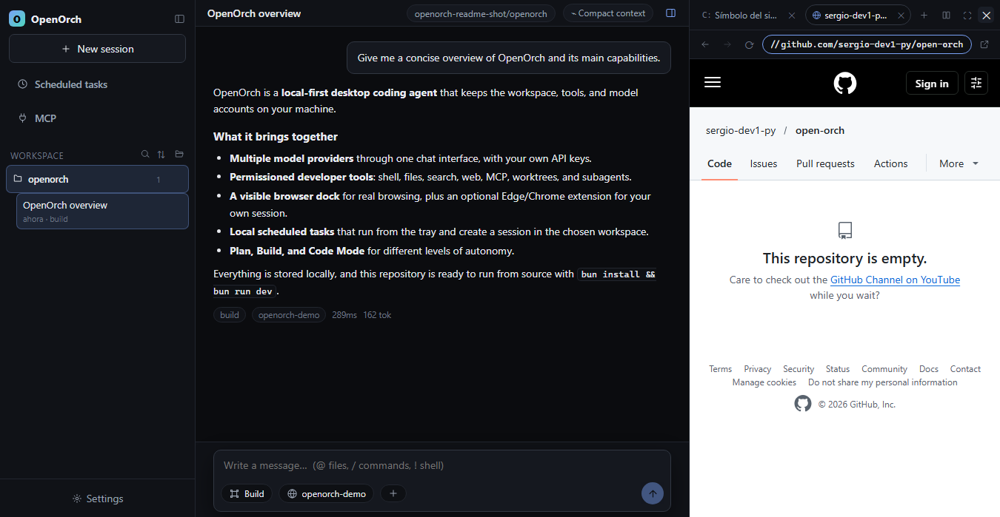

<p align="center">
  
</p>

<h1 align="center">OpenOrch</h1>

<p align="center">
  <strong>Un agente de código de escritorio, local-first.</strong><br />
  Planifica, construye, navega y programa tareas con tus propios modelos desde un solo espacio de trabajo.
</p>

<p align="center">
  <a href="LICENSE"></a>
  
  
  
  
</p>

<p align="center">
  <a href="README.md">English</a> · <strong>Español</strong>
</p>

> OpenOrch es un proyecto independiente inspirado por [OpenCode](https://github.com/anomalyco/opencode).
> No está afiliado, respaldado ni patrocinado por el equipo de OpenCode.

## Por qué OpenOrch

OpenOrch es un harness de escritorio para agentes de código, pensado para trabajar
en tu propia máquina y con tus propias cuentas de modelos. Combina un chat con
herramientas sujetas a permisos, un navegador integrado y automatizaciones
locales sin convertir tu código en un servicio en la nube.

- **Local-first.** Sesiones, mensajes, ajustes, permisos y tareas programadas viven
  en tu equipo. No hace falta una cuenta ni un workspace alojado.
- **Tu proveedor, tu clave.** Anthropic, OpenAI, Google, DeepSeek, xAI, Groq,
  Mistral, Cerebras, Together, OpenRouter, OpenCode Zen/Go o cualquier endpoint
  compatible con OpenAI.
- **Herramientas reales.** Shell, lectura/escritura/edición de archivos, glob,
  búsqueda con ripgrep, web search, fetch, MCP, worktrees y subagentes, con
  permisos configurables.
- **Control del navegador visible.** Navegador aislado dentro del dock o extensión
  opcional para Edge/Chrome, limitada a las pestañas del grupo `OpenOrch`.
- **Tareas programadas locales.** Crea una tarea con su workspace, hora y modelo;
  se ejecuta desde la bandeja. Pausa, reanuda, ejecuta ahora o elimina desde el
  menú `⋯`.
- **Plan, Build y Code Mode.** Alterna entre un agente de planificación de solo
  lectura y el agente de construcción completo; Code Mode permite componer
  llamadas a herramientas en un runtime JavaScript confinado.

## Inicio rápido

### Requisitos

- **Bun 1.4+** (`packageManager`: `bun@1.4.2`)
- **Node.js 20+** para las herramientas y Electron
- **Git**
- Windows, macOS o Linux con escritorio

### Ejecutar desde el código

```bash
git clone https://github.com/sergio-dev1-py/open-orch.git
cd open-orch
bun install
bun run dev
```

La primera instalación descarga el binario de Electron. Si tu entorno bloquea la
descarga, ejecuta el instalador que indique Bun/Electron y vuelve a lanzar
`bun run dev`.

Abre **Ajustes → Proveedores**, pega la API key del proveedor que quieras usar y
guárdala. No hay un `.env` que rellenar: las credenciales se guardan únicamente en
el directorio local de datos de la app.

### Comprobar el proyecto

```bash
bun run typecheck
bun run check:core
bun run check:schedule
bun run check:bridge
bun run e2e
```

| Comando | Qué cubre |
|---|---|
| `bun run typecheck` | TypeScript de shared, core y desktop |
| `bun run check:core` | Agente, proveedores, herramientas, permisos, compactación y catálogo |
| `bun run check:schedule` | Zonas horarias, store de tareas y seguridad del planificador |
| `bun run check:bridge` | Protocolo del puente de la extensión del navegador |
| `bun run e2e` | UI Electron, herramientas, navegador, MCP, tareas y sesiones |

`bun run e2e` usa proveedores y servidores MCP falsos y escribe datos temporales en
`.data/` (ignorado por Git). La suite está orientada a Windows porque prueba
PowerShell, cmd y el navegador del dock; cierra cualquier instancia de OpenOrch
antes de ejecutarla, ya que la app usa un lock de instancia única.

### Compilar

```bash
bun run --cwd apps/desktop build
```

La salida queda en `apps/desktop/out/` y está ignorada. Todavía no hay
configuración de instalador; usa la app de desarrollo o el Electron compilado.

## Qué contiene

```text
apps/desktop       Proceso principal Electron, preload y renderer SolidJS
packages/shared    Tipos compartidos y contratos IPC
packages/core      Motor de agentes, proveedores, herramientas, permisos, MCP y sesiones
extensions/         Extensión MV3 opcional para Edge/Chrome
scripts/            Generadores, proveedores falsos y suites de pruebas
```

El motor es independiente del proveedor y usa AI SDK. La app de escritorio posee la
ventana, SQLite local, la integración con el sistema, el puente del navegador y las
notificaciones.

## Control del navegador

Hay dos modos:

1. **Navegador del dock:** un `<webview>` aislado dentro de OpenOrch. Es la forma
   más sencilla de navegar sin tocar el perfil personal del navegador.
2. **Extensión para Edge/Chrome:** extensión MV3 opcional que se conecta por un
   WebSocket local. Usa `chrome.debugger` y solo actúa en pestañas del grupo
   `OpenOrch`; el resto del navegador queda fuera.

El código de la extensión está en
[`extensions/openorch-browser`](extensions/openorch-browser) (6 archivos, unos
43 KB). Pide `debugger`, `tabs`, `tabGroups`, `storage`, `alarms`, `windows` y
`<all_urls>` porque necesita controlar una pestaña de cualquier sitio que tú
añadas al grupo. El puente escucha solo en `127.0.0.1` y exige el código de
conexión que aparece en **Ajustes → Navegador**.

Instalación local:

1. Abre `edge://extensions` (o `chrome://extensions`).
2. Activa **Modo desarrollador**.
3. Pulsa **Cargar descomprimida** y elige `extensions/openorch-browser`.
4. Copia el código de conexión desde OpenOrch → Ajustes → Navegador.
5. Pégalo en el popup de la extensión y pulsa **Conectar**.

CAPTCHA, login, 2FA y pagos siguen en manos del usuario. La extensión no resuelve
CAPTCHAs, no rellena contraseñas y no lee pestañas fuera del grupo `OpenOrch`. Las
cookies, perfiles, tokens de conexión y estado del puente son locales y no forman
parte de este repositorio.

## Tareas programadas

Son automatizaciones locales, no trabajos en la nube.

- Elige workspace, instrucción, repetición, hora, modelo, esfuerzo y si cada
  ejecución usa un chat nuevo.
- La tarea se guarda de inmediato; la instrucción se ejecuta tal como se escribe,
  sin una ronda de revisión aparte.
- El planificador comprueba cada 30 segundos. Una tarea puede empezar hasta unos
  30 segundos después del minuto elegido y las ejecuciones van de una en una.
- La sesión se crea al ejecutar, en el workspace configurado. Si desactivas
  **nueva sesión por ejecución**, se reutiliza la sesión de la tarea.
- En el menú `⋯` puedes pausar/reanudar, ejecutar ahora o eliminar. Eliminar pide
  confirmación, borra la programación y el historial de ejecuciones, y conserva
  los chats que ya se ejecutaron.
- Al pausar la última tarea en segundo plano también se desactiva **Ejecutar en
  este equipo** y el inicio con Windows, para que cerrar la ventana pueda salir
  normalmente.
- Mientras un workspace trabaja, su carpeta y la sesión concreta muestran un
  estado verde semitransparente. Si el agente espera un permiso o una respuesta,
  pasan a ámbar hasta que respondas.

La app debe estar ejecutándose, o arrancar con Windows/bandeja, a la hora prevista.
Si el equipo estaba apagado, las ejecuciones perdidas se recuperan al arrancar
dentro de las siguientes 24 horas.

## Datos locales y privacidad

En Windows los datos viven en `%APPDATA%\OpenOrch\data`; macOS y Linux usan el
directorio estándar de datos de la aplicación. Según lo que uses, contiene:

- `openorch.db`: sesiones, mensajes, reglas de permisos, tareas e historial
- `config.json`: ajustes y credenciales de proveedores
- `browser-bridge.json`: token local de conexión de la extensión
- `mcp-auth.json`: credenciales OAuth de MCP
- skills, agentes, configuración MCP y preferencias de modelos

Estos archivos están ignorados por Git. Las API keys se guardan en la configuración
local para que la app pueda llamar al proveedor; las protege tu cuenta del sistema
operativo, no un cifrado propio de la aplicación. No compartas este directorio ni
capturas que contengan claves.

El repositorio no incluye código de analítica ni telemetría. Las peticiones de red
ocurren cuando usas un proveedor, web search/fetch, un servidor MCP o el navegador.
Las acciones del agente siguen sujetas a las reglas de permisos que configures.

## Contribuir

Lee [CONTRIBUTING.md](CONTRIBUTING.md) para la instalación, las comprobaciones y
las pull requests. Trabaja en una rama y abre una PR; `main` se mantiene estable.

```bash
git switch main
git pull --ff-only
git switch -c feat/descripcion-corta
# edita y prueba
git add .
git commit -m "feat: describe el cambio"
git push -u origin feat/descripcion-corta
```

Después abre una pull request contra `main`. Activa la protección de rama en
GitHub para exigir PR y evitar pushes directos.

## Licencia y créditos

OpenOrch se publica bajo la [licencia MIT](LICENSE).

Algunos prompts y textos de agentes derivan de
[OpenCode](https://github.com/anomalyco/opencode) (MIT). El aviso y la atribución
obligatorios están en [THIRD_PARTY_NOTICES.md](THIRD_PARTY_NOTICES.md). El catálogo
de modelos embebido deriva de datos de models.dev. OpenOrch es independiente y no
está afiliado a OpenCode, DeepSeek ni Open Design.

Si OpenOrch te resulta útil, las issues y las pull requests enfocadas son
bienvenidas.
